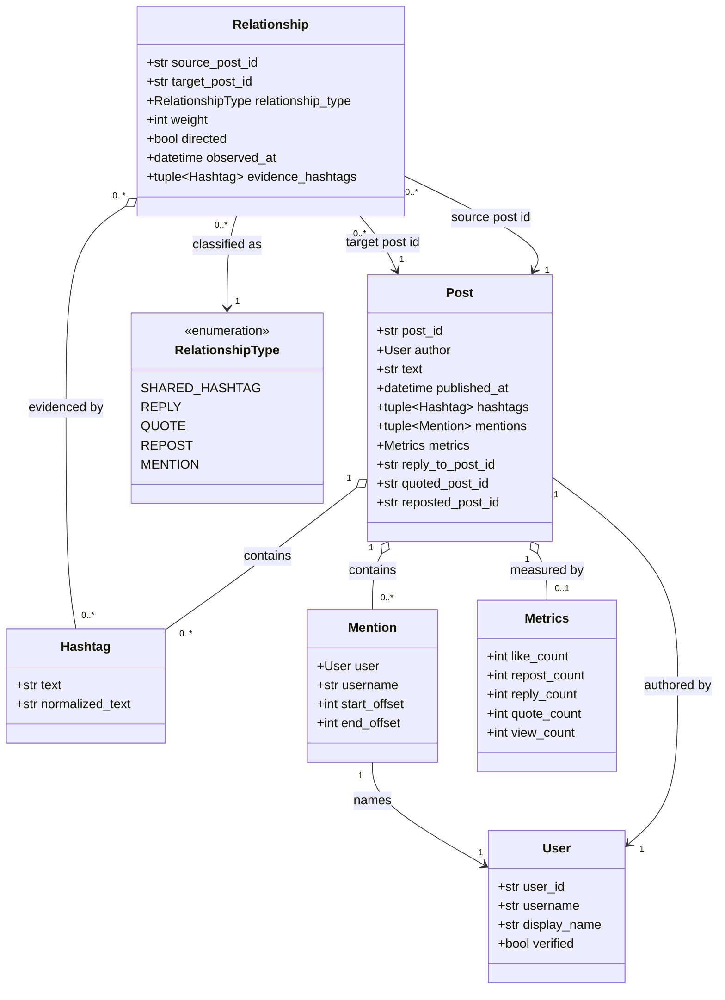

# Domain Model

The domain model is intentionally independent of the X API, graph library,
database, and visualization framework. It represents collected facts and typed
relationships; preprocessing and analysis belong in application services.

## Mermaid UML class diagram

## Entity responsibilities

- **User** identifies an account and preserves the stable username metadata
  available at collection time.
- **Post** is the central content entity. It owns immutable references to its
  author, hashtags, mentions, metrics, and direct post references for replies,
  quotes, and reposts.
- **Hashtag** separates display text from a canonical comparison form. The
  model stores both values; normalization is deliberately not implemented here.
- **Mention** records the mentioned user and optional text offsets. The
  username is retained because it is part of the observed post content.
- **Metrics** stores a point-in-time snapshot of engagement counts.
- **Relationship** is a directed typed edge between two post identifiers.
  `SHARED_HASHTAG`, `REPLY`, `QUOTE`, `REPOST`, and `MENTION` are the supported
  relationship types. The `directed` flag distinguishes interactions from
  similarity edges, and `weight` stores the edge weight.

TODO: Decide whether a mention should connect a post to every post authored by
the mentioned user, to a specific referenced post, or remain a user-level edge.

All dataclasses use `frozen=True` and `slots=True`. Collections are tuples so
the model does not expose mutable lists. IDs are represented as strings for now
to remain compatible with external platform identifiers and future sources.

TODO: Decide whether source-qualified IDs, provenance, deleted-content markers,
and metric collection timestamps need dedicated value objects.